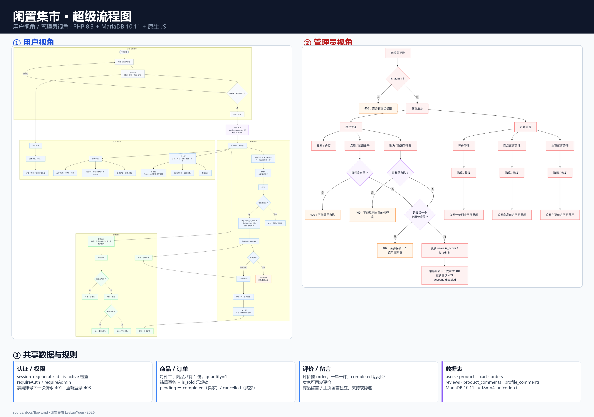

# Campus Market · LeeLapYuen

**Campus Market** is a campus second-hand marketplace. The original project was native PHP pages talking
straight to MySQL (see `legacy/`); it has since been rebuilt as a **RESTful API + vanilla JS single page app**.

> What you no longer need, someone else does.

---

## Super Flowchart

[](docs/flows.md)

The diagram above covers both the **user view** and the **admin view**; click it for the editable
[Mermaid source](docs/flows.md) (GitHub renders it directly).

---

## Tech Stack

| Layer | What | Notes |
|---|---|---|
| Backend | PHP 8.3 (native, no framework) | Namespaces + a hand-written autoloader, no Composer |
| Database | MariaDB 10.11+ (MySQL-protocol compatible) | InnoDB, with foreign keys and CHECK constraints |
| Frontend | Vanilla JS + CSS (no framework, no build) | Hash routing, `fetch` against the API |
| Server | PHP built-in server (dev) / Apache (production) | `public/router.php` acts as the front controller |

**Why no framework**: the original project was zero-dependency native PHP. Keeping that shape while
fixing how the code is organised (layering, namespaces, exception handling) fits this project better
than pulling in Laravel — and it says "I understand these concepts, not just one framework's API".

---

## Directory Structure

```
Server/
├── config/
│   ├── config.php              config (default password 123456, overridable via environment variables)
│   └── config.local.php        local override config (gitignored, optional)
├── database/
│   └── online_marketplace.sql  full demo data (111 listings / 3 accounts / sample comments)
├── migrations/
│   ├── 001_schema.sql          creates the tables
│   ├── 002_seed.sql            categories + demo accounts
│   ├── 003_campus_seed.sql     the 12 campus second-hand listings
│   ├── 004_account_admin.sql   avatar + account enabled state
│   ├── 005_reviews_comments.sql review replies / comments / bio
│   └── migrate_legacy.php      migrates the 100 listings from the old db_01 database
├── src/
│   ├── bootstrap.php           autoloading / error handling / sessions
│   ├── Database.php            PDO singleton + transaction wrapper
│   ├── Auth/Auth.php           sessions, login/logout, three guards
│   ├── Http/
│   │   ├── ApiException.php    exception carrying an HTTP status
│   │   ├── Request.php         request wrapper with type coercion
│   │   ├── Response.php        unified JSON envelope
│   │   └── Router.php          minimal router (dynamic segments + grouped middleware)
│   ├── Models/
│   │   ├── Model.php           base class: whitelist filtering + CRUD
│   │   ├── User.php
│   │   ├── Product.php         ★ paginated queries (with the sort-key fix)
│   │   ├── Category.php
│   │   ├── CartItem.php        add / de-duplicate / totals
│   │   ├── Order.php           ★ checkout transaction
│   │   ├── Review.php          ★ transaction reviews + seller replies
│   │   ├── ProductComment.php  ★ listing comments
│   │   ├── ProfileComment.php  ★ profile comments
│   │   └── Stats.php           home page stats
│   ├── Api/                    one named function per endpoint: Create 8 / Read 25 / Update 19 / Delete 7
│   │   ├── Create.php          8 create functions (register, listing, report, cart, order, comment, review)
│   │   ├── Read.php            25 read functions (listings, users, cart, orders, comments, stats, admin lists)
│   │   ├── Update.php          19 update functions (account, listings, orders, reviews, payments, admin)
│   │   ├── Delete.php          7 delete functions (logout, listings, cart, comments, admin)
│   │   └── helpers.php         request singleton, pagination meta, hidden flag, eBay price lookup
│   └── Support/
│       ├── Validate.php        chained validation, returns all field errors at once
│       └── Upload.php          image upload (real MIME check + random filenames)
├── public/                     ← DocumentRoot should point here
│   ├── index.html              archive portal landing page
│   ├── market.html             market single page app shell
│   ├── api/index.php           61 routes mapped directly onto 59 named functions
│   ├── router.php              front controller for the PHP built-in server (development)
│   ├── .htaccess               Apache rewrite rules (production)
│   ├── assets/
│   │   ├── app.js              front-end app (routing + views + API wrapper)
│   │   └── style.css
│   └── uploads/                user-uploaded images
├── docs/
│   ├── flows.md                user / admin super flowchart (Mermaid source)
│   ├── flows.png               super flowchart poster
│   ├── flows-user.png          large user-view diagram
│   └── flows-admin.png         large admin-view diagram
├── tests/
│   └── api_test.sh             end-to-end tests (auth / account / listings / cart / checkout / cancel / reviews / comments / admin)
├── legacy/                     ← pre-refactor code, kept for reference only, not part of the running app
│                               (the old SQL dumps are still MySQL 8 format; do not import them into MariaDB directly)
│   ├── main.php                old listing page (PHP rendering straight from the database)
│   ├── login_regsiter.php      old login/registration page
│   ├── LeeLapYuen.php          an earlier registration page (never persisted to the database)
│   ├── Check/                  old form-handling scripts
│   ├── CSS/ JavaScript/        old styles and scripts
│   ├── db_connect.php          old connection file (with a hard-coded root password)
│   └── sql-dumps/              original SQL dumps (db_01 / online_marketplace / phpmyadmin)
└── setup.sh                    one-shot WSL deploy / reset
```

---

## Quick Start (WSL)

```bash
bash setup.sh            # install the stack + create the database + import demo data + start the server
bash setup.sh --keep-db  # refresh code and server only, leave the database alone
```

> The database is **MariaDB 10.11+**; `setup.sh` installs and initialises it automatically.
> A fresh install imports `database/online_marketplace.sql` straight from the repo:
> 111 listings, 3 demo accounts, 3 listing comments, 1 profile comment.
> If the machine already has MySQL 8 installed, back up and move `/var/lib/mysql` away before
> installing MariaDB: MariaDB cannot reuse a MySQL 8 data directory.
> If you are only refreshing code on an existing database (`--keep-db`), run the new migrations by
> hand: `migrations/004_account_admin.sql` and `migrations/005_reviews_comments.sql`; a fresh
> install runs them automatically.

### Database Connection (Demo Environment)

| Item | Value |
|---|---|
| Host | `127.0.0.1:3306` |
| Database | `online_marketplace` |
| User | `root` |
| Password | `123456` |

> This is a demo password, deliberately written out here; **change it before going live**, and do not
> put real data behind it.
> If the local MariaDB root already uses another password, run `MYSQL_ROOT_PW=<current password> bash setup.sh`.

Then open **http://localhost:8000/** — that is the archive portal; click "ENTER THE MARKET" to reach
the app itself (`public/market.html`).

Demo accounts (see `database/online_marketplace.sql`):

| Email | Password | Notes |
|---|---|---|
| admin@example.com | admin1234 | Admin, can open the "Admin" backend |
| alice@example.com | alice1234 | Regular user |
| bob@example.com | bob1234 | Regular user |

**Suggested demo walkthrough**: log in as alice → pick one of bob's listings → add it to the cart →
check out (creates a `pending` order) → switch to bob and click "Mark complete" under "Sold by me"
→ switch back to alice and review the order under "Orders". This path touches all five tables.
alice can also cancel the order while it is `pending`, and the listing goes back on sale by itself.
The sidebar leads to "Account settings / My listings / Admin backend"; the listing detail page has
two independent sections below it, "Listing comments" and "Reviews"; a seller profile has three tabs,
"For sale / Reviews received / Comment board". Logged in as admin, the sidebar gains an extra "Admin backend" entry.

### Manual Start

```bash
cd ~/Server/public
php -S 0.0.0.0:8000 router.php     # foreground, logs straight to the terminal
```

The default database password is `123456`; if you changed it, override it with the `DB_PASSWORD`
environment variable or `config/config.local.php`.

### Running the Tests

```bash
bash tests/api_test.sh             # port 8000 by default
```

The tests create temporary listings and orders and clean them up at the end, without deleting the
111 seed listings; the cleanup step uses the database password `123456` by default and also accepts
a `DB_PASSWORD` override.

---

## API Documentation

`public/api/index.php` declares 61 routes that map directly onto 59 named functions in `src/Api/`;
`PATCH`, `PUT` and `POST` on `/products/{id}` all share `updateProduct`.

Unified envelope:

```jsonc
// success
{ "data": {...}, "meta": { "pagination": {...} } }

// failure
{ "error": { "code": "validation_failed", "message": "input failed validation",
             "details": { "email": "not a valid email address" } } }
```

### Authentication

| Method | Path | Notes |
|---|---|---|
| `POST` | `/api/v1/auth/register` | Register; logs in automatically on success, returns 201 |
| `POST` | `/api/v1/auth/login` | Log in |
| `POST` | `/api/v1/auth/logout` | Log out, returns 204 |
| `GET` | `/api/v1/auth/me` | Current user; returns `{"data":null}` when logged out (not 401) |

```bash
curl -c jar.txt -H 'Content-Type: application/json' \
  -d '{"email":"alice@example.com","password":"alice1234"}' \
  http://localhost:8000/api/v1/auth/login
```

### Account Settings

| Method | Path | Notes |
|---|---|---|
| `PATCH` | `/api/v1/account` | Change `username` / `email` / `bio`; changing the email also needs `current_password` |
| `POST` | `/api/v1/account/password` | `current_password` + `password` + `password_confirmation`; rotates the session id on success |
| `POST` | `/api/v1/account/avatar` | `multipart/form-data`, field name `avatar`; reuses the image upload validation |

`GET /auth/me` returns the current user's `email`, `avatar_path`, `is_admin` and `is_active`.

`GET /auth/me` also returns `level` (level 1–6); `total_spent` (cumulative spend on completed orders) is visible only to the user and admins.

`GET /auth/me` and public profiles also return `seller_level` (seller level 1–6).

### Listings

| Method | Path | Permission | Notes |
|---|---|---|---|
| `GET` | `/api/v1/products` | Public | List; see the query parameters below |
| `GET` | `/api/v1/products/mine` | Signed in | My listings (including sold ones) |
| `POST` | `/api/v1/products` | Signed in | Publish (accepts `multipart/form-data` for images) |
| `GET` | `/api/v1/products/{id}` | Public | Detail (including the seller's rating) |
| `GET` | `/api/v1/products/{id}/image` | Public | Listing image (BLOB; old data falls back to `image_path`; cached hard for 1 day) |
| `PATCH` / `PUT` / `POST` | `/api/v1/products/{id}` | Seller only | Edit (JSON via `PATCH` or `PUT`; multipart forms via `POST`, because PHP only parses files for POST) |
| `DELETE` | `/api/v1/products/{id}` | Seller only | Delete (refused when orders exist) |
| `GET` | `/api/v1/products/{id}/reviews` | Public | Reviews for this listing (paginated, including seller replies) |
| `GET` | `/api/v1/products/{id}/comments` | Public | Listing comments (paginated, including seller replies) |
| `POST` | `/api/v1/products/{id}/comments` | Signed in | Post a comment; body `{body, parent_id?}` |
| `DELETE` | `/api/v1/products/{id}/comments/{commentId}` | Signed in | Delete/hide a comment (author/seller/admin) |
| `GET` | `/api/v1/categories` | Public | Two-level categories (`parent_id`) + the number of listings for sale in each |

Query parameters: `page`, `per_page` (≤100), `category_id`, `search`,
`min_price`, `max_price`, `status` (`new`/`used`/`damaged`),
`seller_id`, `include_sold` (`1` includes sold listings).

When `category_id` is a parent category, the response includes listings from that category and all of its children.

```bash
curl 'http://localhost:8000/api/v1/products?category_id=1&min_price=20&max_price=100&status=used'
```

### Cart

| Method | Path | Notes |
|---|---|---|
| `GET` | `/api/v1/cart` | Line items + total (unavailable listings are listed separately and left out of the total) |
| `POST` | `/api/v1/cart` | Add; if it already exists the API just returns `created:false` (one entry per listing) |
| `DELETE` | `/api/v1/cart/{id}` | Remove a single item |
| `DELETE` | `/api/v1/cart` | Clear |

### Orders

| Method | Path | Notes |
|---|---|---|
| `GET` | `/api/v1/orders?role=buyer\|seller` | What I bought / what I sold |
| `POST` | `/api/v1/orders` | Check out the cart, creating `pending` orders; the body may carry `{"cart_ids":[...]}` |
| `GET` | `/api/v1/orders/{id}` | Detail (buyer and seller only) |
| `PATCH` | `/api/v1/orders/{id}` | Change status (state machine below) |

State machine: `pending → completed` (the **seller** confirms the sale) / `pending → cancelled` (the **buyer** cancels).
Cancelling puts the listing back on sale (`is_sold` set back to 0). Only `completed` orders can be reviewed.
At checkout, cart entries that are already sold are skipped automatically; if none can be checked out, the API returns 409.

### Reviews / Users

| Method | Path | Notes |
|---|---|---|
| `POST` | `/api/v1/orders/{id}/review` | Review an order (buyer only, the order must be `completed`, one review per order) |
| `POST` | `/api/v1/reviews/{id}/reply` | Seller replies to a review (body `{reply}`, can be overwritten) |
| `GET` | `/api/v1/users/{id}` | Public profile + for-sale/sold counts + rating |
| `GET` | `/api/v1/users/{id}/reviews` | Reviews this user received + average score (paginated) |
| `GET` | `/api/v1/users/{id}/comments` | Profile comment board (paginated) |
| `POST` | `/api/v1/users/{id}/comments` | Comment once signed in; body `{body}` |
| `DELETE` | `/api/v1/users/{id}/comments/{commentId}` | Delete/hide a comment (author/profile owner/admin) |

### Admin

| Method | Path | Notes |
|---|---|---|
| `GET` | `/api/v1/admin/users` | User list, supports `search`, `page`, `per_page` |
| `PATCH` | `/api/v1/admin/users/{id}` | Change `is_admin` / `is_active` |
| `GET` | `/api/v1/admin/reviews` | Review list (including hidden ones) |
| `PATCH` | `/api/v1/admin/reviews/{id}` | `{is_hidden}` hides/restores a review |
| `GET` | `/api/v1/admin/product-comments` | Listing comment list (including hidden ones) |
| `PATCH` | `/api/v1/admin/product-comments/{id}` | Hide/restore a listing comment |
| `GET` | `/api/v1/admin/profile-comments` | Profile comment list (including hidden ones) |
| `PATCH` | `/api/v1/admin/profile-comments/{id}` | Hide/restore a profile comment |

Constraints: you cannot disable or demote yourself; the system always keeps at least one account that
is both enabled and an admin. A disabled user is logged out automatically on the next request, and
login returns 403 `account_disabled`.

### Other

| Method | Path | Notes |
|---|---|---|
| `GET` | `/api/v1/health` | Health check (PHP version + database version + time) |
| `GET` | `/api/v1/stats` | Home page stats (for sale / sold / users / order count) |

### Status Code Conventions

`200` success · `201` created · `204` deleted, no response body ·
`400` malformed parameter · `401` not signed in · `403` signed in but not allowed ·
`404` resource not found · `405` wrong method · `409` state conflict (already sold / duplicate review / order status not allowed / nothing to check out / last admin) ·
`422` validation failed (with field-level `details`) · `500` server error

---

## Data Model

It keeps the original `online_marketplace` design; a few points are worth explaining:

```
users ──┬── products (seller_id)         seller
        ├── cart (user_id)
        ├── orders (buyer_id)            buyer
        └── reviews (buyer_id / seller_id)
                 │
products ────────┴── orders (product_id)
                 └── cart (product_id)
                          │
reviews ──────────────────┴── orders (order_id)   ← a review belongs to an order
```

`users` gained `avatar_path` (avatar), `is_active` (enabled state) and
`bio` (short bio) in migrations 004 / 005; `is_admin` is now really used by the admin backend guard.

006 added `total_spent` (cumulative spend on completed orders) and `level` (1–6, only ever goes up).
Existing databases need `mysql ... online_marketplace < migrations/006_user_levels.sql` run by hand
(`setup.sh --keep-db` does not run migrations automatically).

007 added `seller_level` (seller level 1–6, raised by the number of completed sales:
≥1 → 2, ≥10 → 3, ≥100 → 4, ≥1000 → 5, ≥2000 → 6, only ever goes up).
Existing databases upgrade by hand too: `mysql ... online_marketplace < migrations/007_seller_levels.sql`.

After 008, `categories` became two-level: `parent_id IS NULL` is a parent category, otherwise a child.
The old 6 categories keep their ids as child categories, and the 111 listings keep their `category_id`
unchanged; 8 parent categories were added, of which Furniture / Beauty & Skincare / Jewellery &
Accessories have no children yet.

009 added `image_blob` (LONGBLOB) and `image_mime` to `products`: newly uploaded images keep both the
file and the BLOB, and the 111 old listings are not backfilled; `GET /api/v1/products/{id}/image`
falls back to the `image_path` file when the BLOB is empty, and the response carries
`Cache-Control: public, max-age=86400`.

`product_comments` (listing comments) and `profile_comments` (profile comments) are separate tables:
comments do not feed into ratings, and a review still belongs to a single transaction.

**Hanging reviews off `orders` rather than `products`** is the best design decision in this schema:
a review belongs to "one transaction", not "one listing". If the same listing is resold twice, the two
transactions should be reviewed separately. `UNIQUE KEY uniq_order` enforces one review per order.

`orders` is "one row per listing", not "one order with several rows" — on a second-hand marketplace
every item exists once, so checking out N cart items produces N records, each with `quantity` fixed
at 1. That is a trade-off of the original design, kept as is.

---

## What This Refactor Changed

### Real Defects Fixed

| Issue | Before | After |
|---|---|---|
| **Pagination lost listings** | `ORDER BY created_at DESC`, and all 100 rows shared the same `created_at` → 9 pages could only return 71 distinct listings, 29 were unreachable forever, and pages 1 and 2 overlapped by 11 | `ORDER BY created_at DESC, id DESC`; a dedicated test asserts that two pages do not overlap |
| **Registration validation was a no-op** | Validation only assigned `$message` without aborting, so invalid usernames / short passwords were INSERTed anyway | `Validate` chains its checks, throws 422 with field-level errors, and performs no write |
| **Status filter returned 500** | The code queried `products.status`, a column the table did not have, so `ERRMODE_EXCEPTION` produced a blank page | Schema and code now agree |
| **Hard-coded credentials** | `db_connect.php` hard-coded the root password | The demo project standardises on the simple password `123456` (written out in the README); `DB_PASSWORD` / `config.local.php` can override it, and it must be changed before going live |
| **Plaintext seed accounts** | The dump contained `('admin','admin','admin@admin.com1')` | Everything is bcrypt-hashed; plaintext only appears in the README's demo account table |
| **Reflected XSS** | `value="<?php echo $_POST['UserName'];?>"` | Everything in the front end goes through `esc()`; the old pages under `legacy/` are isolated |
| **Session fixation** | Login did not rotate the session id | `session_regenerate_id(true)` |
| **Error details leaked** | `$e->getMessage()` was echoed straight back | 500 returns only a generic message; details go to `error_log` |
| **Dangling include** | `include login_register.php` (a file that did not exist) | Removed |
| **Duplicate implementation** | Two registration paths (`Check/` + `LeeLapYuen.php`) coexisted | Unified in the API layer (`registerUser` in `src/Api/Create.php`); the old code moved to `legacy/` |

### Newly Added Features

- **Publishing listings** — the core verb was not implemented at all; there is now a form + image upload
- **Listing detail page** — used to be a skeleton of a few empty divs
- **Cart** — add / de-duplicate / clear, with a total
- **Checkout** — transactional checkout, with concurrency protection
- **Reviews** — one per order, score 1–5
- **Seller profile** — public profile + listings for sale + rating
- **Account settings** — change username / email / password / avatar / bio; changing the email needs the current password
- **My listings** — edit and delete your own listings (sold ones cannot be edited)
- **Listing comments** — pre-sale Q&A, sellers can reply; independent of ratings
- **Review replies** — sellers can reply to transaction reviews
- **Profile page** — avatar / bio / for sale / sold / rating + review list + comment board
- **Sidebar** — fixed navigation on desktop, a drawer on mobile
- **Admin backend** — enable/disable and hide for users / reviews / listing comments / profile comments

### Engineering Changes

- PDO prepared statements throughout + `EMULATE_PREPARES=false`; the `Model::$fillable` whitelist stops a
  request body from smuggling in fields such as `is_admin` to escalate privileges
- Every warning/notice is promoted to an exception — no more "fails silently and returns half a JSON"
- Checkout goes through `Database::transaction()`; `rowCount()` from
  `UPDATE ... WHERE is_sold = 0` serves as an optimistic lock, so when two people buy the same listing
  at once the second gets a 409 instead of a double sale
- Changing the password requires the current password and `session_regenerate_id(true)`; changing the
  email requires the current password too
- A disabled account is logged out automatically inside `Auth::user()`; admins cannot disable or demote
  themselves, and at least one enabled admin is always kept
- Uploads use `finfo` for the real MIME type + a second `getimagesize()` check + random filenames,
  which blocks "renamed .php images"

---

## Known Limitations

- **No CSRF token**. Mitigated for now by a `SameSite=Lax` cookie. Because this is a same-origin SPA
  that only runs locally, the risk is limited; a public deployment should add tokens.
- **No cursor version of pagination**. `LIMIT/OFFSET` degrades on large data sets; at this scale it
  does not matter.
- **Each second-hand listing exists once**, so `quantity` in the cart and in orders is fixed at 1;
  supporting bulk/stock would need a `stock` column.
- **No password reset, no email verification**; changing the email only verifies the current password,
  not ownership of the address.
- **The admin backend only covers users and content hiding**, with no audit log and no report handling.
- **Only buyers review sellers**, there is no seller-to-buyer review; reviews and comments do not support images.
- **Avatars and listing images live on the filesystem only**; a multi-machine deployment needs object storage.
- **No rate limiting at all**, so the login endpoint can be brute-forced. Acceptable for a local demo.

---

## Production Deployment (Apache)

1. Point `public/` at the DocumentRoot, enable `mod_rewrite` and `mod_headers`
2. Set the environment variables: `DB_USER`, `DB_PASSWORD`, `DB_NAME`, `APP_DEBUG=0`
3. `chmod 755 public/uploads` (must be writable)
4. Make sure `public/.htaccess` takes effect (`AllowOverride All`)

If you can only deploy in a subdirectory, change `RewriteBase` in `public/.htaccess`.
