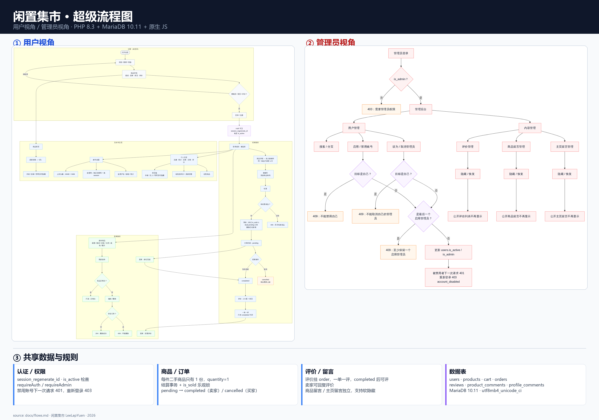

# 闲置集市 · 超级流程图

> 上面这张图同时包含**用户视角**和**管理员视角**；如果觉得字小，可以看单视角大图：
> [用户视角大图](flows-user.png) · [管理员视角大图](flows-admin.png)。
> 下面是可编辑的 Mermaid 源码，GitHub 会直接渲染。

## 用户视角

~~~mermaid
flowchart TB
  classDef guest fill:#f8fafc,stroke:#94a3b8,color:#0f172a
  classDef user fill:#eff6ff,stroke:#60a5fa,color:#0f172a
  classDef seller fill:#f0fdf4,stroke:#4ade80,color:#0f172a
  classDef state fill:#fff7ed,stroke:#fb923c,color:#0f172a
  classDef guard fill:#faf5ff,stroke:#c084fc,color:#0f172a

  subgraph G["访客（未登录）"]
    V1([打开首页]) --> V2["浏览 / 搜索 / 筛选"]
    V2 --> V3["商品详情 描述 · 卖家 · 留言 · 评价"]
    V3 --> V4{"要购买 / 留言 / 评价？"}
    V4 -->|继续逛| V2
    V4 -->|是| V5["登录 / 注册"]
  end

  V5 --> AUTH["Auth 守卫 session_regenerate_id 检查 is_active"]
  AUTH --> H["登录成功 · 侧边栏"]

  subgraph BUY["买家路径"]
    H --> B1["商品详情 → 加入购物车 同一商品只保留 1 行"]
    B1 --> B2["购物车 失效商品单列"]
    B2 --> B3["结算"]
    B3 --> B4{"有在售商品？"}
    B4 -->|没有| B5["409：无可结算商品"]
    B4 -->|有| B6["事务：标记 is_sold=1 生成 pending 订单 删除已结算项"]
    B6 --> B7["订单列表：pending"]
    B7 --> B8{"买家操作"}
    B8 -->|取消| B9["cancelled 商品重新上架"]
    B8 -->|等待卖家| B10["completed"]
    B10 --> B11["评价：1-5 星 + 留言"]
    B11 --> B12["一单一评 只有 completed 可评"]
  end

  subgraph SELL["卖家路径"]
    H --> S1["发布商品 标题 / 描述 / 价格 / 分类 / 成色 / 图片"]
    S1 --> S2["我的发布"]
    S2 --> S3{"商品已售出？"}
    S3 -->|否| S4["编辑 / 删除"]
    S3 -->|是| S5["只读：已售出"]
    S4 --> S6{"存在订单？"}
    S6 -->|是| S7["409：不能删除"]
    S6 -->|否| S8["204：删除成功"]
    B7 --> S9["卖家：标记完成"]
    S9 --> B10
    B12 --> S10["卖家：回复评价"]
  end

  subgraph SOCIAL["互动与主页"]
    V3 --> C1["商品留言"]
    C1 --> C2["卖家回复（一层）"]
    C2 --> C3["作者 / 卖家 / 管理员可隐藏"]
    H --> P1["个人主页 头像 · 简介 · 在售 · 已售 · 评分"]
    P1 --> P2["在售商品"]
    P1 --> P3["收到的评价 + 卖家回复"]
    P1 --> P4["留言板 作者 / 主人 / 管理员可隐藏"]
    H --> AC["账号设置"]
    AC --> AC1["改用户名 / 邮箱 / 简介"]
    AC --> AC2["改密码：验证旧密码 + 换 session"]
    AC --> AC3["上传头像：MIME + 5MB"]
  end

  class V1,V2,V3,V4,V5 guest
  class H,B1,B2,B3,B4,B5,B6,B7,B8,B10,B11,B12,C1,C2,C3,P1,P2,P3,P4,AC,AC1,AC2,AC3 user
  class S1,S2,S3,S4,S5,S6,S7,S8,S9,S10 seller
  class B9 state
  class AUTH guard
~~~

## 管理员视角

~~~mermaid
flowchart TB
  classDef admin fill:#fef2f2,stroke:#f87171,color:#0f172a
  classDef guard fill:#faf5ff,stroke:#c084fc,color:#0f172a
  classDef state fill:#fff7ed,stroke:#fb923c,color:#0f172a

  L["管理员登录"] --> G{"is_admin？"}
  G -->|否| X["403：需要管理员权限"]
  G -->|是| D["管理后台"]

  D --> U["用户管理"]
  D --> C["内容管理"]

  U --> U1["搜索 / 分页"]
  U --> U2["启用 / 禁用账号"]
  U --> U3["设为 / 取消管理员"]
  U2 --> U4{"目标是自己？"}
  U3 --> U5{"目标是自己？"}
  U4 -->|是| E1["409：不能禁用自己"]
  U5 -->|是| E2["409：不能取消自己的管理员"]
  U4 -->|否| U6{"是最后一个 启用管理员？"}
  U5 -->|否| U6
  U6 -->|是| E3["409：至少保留一个 启用管理员"]
  U6 -->|否| U7["更新 users.is_active / is_admin"]
  U7 --> U8["被禁用者下一次请求 401 重新登录 403 account_disabled"]

  C --> C1["评价管理"]
  C --> C2["商品留言管理"]
  C --> C3["主页留言管理"]
  C1 --> C4["隐藏 / 恢复"]
  C2 --> C5["隐藏 / 恢复"]
  C3 --> C6["隐藏 / 恢复"]
  C4 --> C7["公开评价列表不再显示"]
  C5 --> C8["公开商品留言不再显示"]
  C6 --> C9["公开主页留言不再显示"]

  class L,G,D,U,C,U1,U2,U3,U7,U8,C1,C2,C3,C4,C5,C6,C7,C8,C9 admin
  class X,E1,E2,E3 state
  class U4,U5,U6 guard
~~~

## 订单 / 评价 / 留言状态机

~~~mermaid
stateDiagram-v2
  [*] --> pending: 买家结算（事务）
  pending --> completed: 卖家标记完成
  pending --> cancelled: 买家取消
  cancelled --> [*]: 商品重新上架
  completed --> [*]: 买家评价（一单一评）

  state "商品留言 / 主页留言" as comments {
    [*] --> visible
    visible --> hidden: 作者 / 卖家 / 主人 / 管理员
    hidden --> visible: 管理员恢复
    hidden --> [*]
  }
~~~

## 关键接口

| 阶段 | 接口 | 说明 |
|---|---|---|
| 认证 | `POST /auth/register` / `POST /auth/login` | 注册 / 登录，成功后建会话 |
| 商品 | `GET /products` / `GET /products/{id}` | 浏览、搜索、筛选 |
| 发布 | `POST /products` | 卖家发布，支持图片 |
| 我的发布 | `GET /products/mine` / `PATCH` / `POST /products/{id}` / `DELETE` | 编辑、删除自己的商品 |
| 购物车 | `POST /cart` / `GET /cart` / `DELETE /cart/{id}` | 每件商品只有 1 份 |
| 结算 | `POST /orders` | 事务生成 pending 订单，跳过已售出 |
| 订单 | `PATCH /orders/{id}` | 卖家完成 / 买家取消 |
| 评价 | `POST /orders/{id}/review` / `POST /reviews/{id}/reply` | 一单一评，卖家回复 |
| 商品留言 | `GET` / `POST /products/{id}/comments` | 售前问答，支持卖家回复 |
| 主页留言 | `GET` / `POST /users/{id}/comments` | 个人主页留言板 |
| 账号 | `PATCH /account` / `POST /account/password` / `POST /account/avatar` | 资料 / 密码 / 头像 |
| 管理 | `GET` / `PATCH /admin/users` / `/admin/reviews` / `/admin/product-comments` / `/admin/profile-comments` | 用户与内容治理 |

## 关键规则

1. 未登录可以浏览、搜索、看商品详情、看评价和留言；购买、发布、留言、评价需要登录。
2. 每件二手商品只有一份，`cart.quantity = 1`；结算时已售出的条目会被跳过，全部失效则 409。
3. 订单状态机：`pending → completed`（卖家）/ `pending → cancelled`（买家，商品重新上架）。
4. 只有 `completed` 订单可以评价；一单一评；卖家可回复评价。
5. 商品留言和主页留言独立于评分；商品留言支持一层卖家回复；作者/卖家/主人/管理员可软隐藏。
6. 管理员不能禁用或降级自己；系统至少保留一个启用状态的管理员；被禁用账号下一次请求即失效。
