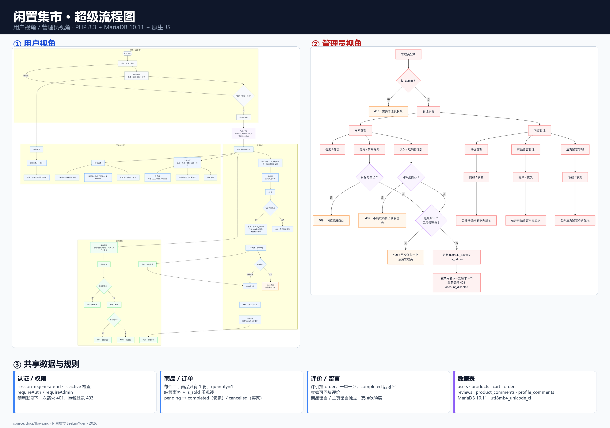

# Second-hand Marketplace · Master Flowchart

> The diagram above covers both the **user view** and the **admin view**; if the text is too small, see the single-view diagrams:
> [User view (large)](flows-user.png) · [Admin view (large)](flows-admin.png).
> The editable Mermaid source is below; GitHub renders it directly.

## User flow

~~~mermaid
flowchart TB
  classDef guest fill:#f8fafc,stroke:#94a3b8,color:#0f172a
  classDef user fill:#eff6ff,stroke:#60a5fa,color:#0f172a
  classDef seller fill:#f0fdf4,stroke:#4ade80,color:#0f172a
  classDef state fill:#fff7ed,stroke:#fb923c,color:#0f172a
  classDef guard fill:#faf5ff,stroke:#c084fc,color:#0f172a

  subgraph G["Guest (not signed in)"]
    V1([Open home page]) --> V2["Browse / Search / Filter"]
    V2 --> V3["Listing detail description · seller · comments · reviews"]
    V3 --> V4{"Buy / comment / review?"}
    V4 -->|Keep browsing| V2
    V4 -->|Yes| V5["Log in / Sign up"]
  end

  V5 --> AUTH["Auth guard session_regenerate_id checks is_active"]
  AUTH --> H["Logged in · sidebar"]

  subgraph BUY["Buyer path"]
    H --> B1["Listing detail → add to cart one row per listing"]
    B1 --> B2["Cart unavailable listings shown separately"]
    B2 --> B3["Checkout"]
    B3 --> B4{"Any listings on sale?"}
    B4 -->|No| B5["409: nothing to check out"]
    B4 -->|Yes| B6["Transaction: set is_sold=1 create pending orders remove checked-out rows"]
    B6 --> B7["Order list: pending"]
    B7 --> B8{"Buyer action"}
    B8 -->|Cancel| B9["cancelled listing goes back on sale"]
    B8 -->|Wait for seller| B10["completed"]
    B10 --> B11["Review: 1-5 stars + comment"]
    B11 --> B12["One review per order only completed can be reviewed"]
  end

  subgraph SELL["Seller path"]
    H --> S1["Create listing title / description / price / category / condition / images"]
    S1 --> S2["My listings"]
    S2 --> S3{"Listing sold?"}
    S3 -->|No| S4["Edit / Delete"]
    S3 -->|Yes| S5["Read-only: sold"]
    S4 --> S6{"Any orders?"}
    S6 -->|Yes| S7["409: cannot delete"]
    S6 -->|No| S8["204: deleted"]
    B7 --> S9["Seller: mark completed"]
    S9 --> B10
    B12 --> S10["Seller: reply to review"]
  end

  subgraph SOCIAL["Engagement and profile"]
    V3 --> C1["Listing comments"]
    C1 --> C2["Seller reply (one level)"]
    C2 --> C3["Author / seller / admin can hide"]
    H --> P1["Profile page avatar · bio · on sale · sold · rating"]
    P1 --> P2["Listings on sale"]
    P1 --> P3["Reviews received + seller replies"]
    P1 --> P4["Comment board author / owner / admin can hide"]
    H --> AC["Account settings"]
    AC --> AC1["Change username / email / bio"]
    AC --> AC2["Change password: verify old password + rotate session"]
    AC --> AC3["Upload avatar: MIME + 5MB"]
  end

  class V1,V2,V3,V4,V5 guest
  class H,B1,B2,B3,B4,B5,B6,B7,B8,B10,B11,B12,C1,C2,C3,P1,P2,P3,P4,AC,AC1,AC2,AC3 user
  class S1,S2,S3,S4,S5,S6,S7,S8,S9,S10 seller
  class B9 state
  class AUTH guard
~~~

## Admin flow

~~~mermaid
flowchart TB
  classDef admin fill:#fef2f2,stroke:#f87171,color:#0f172a
  classDef guard fill:#faf5ff,stroke:#c084fc,color:#0f172a
  classDef state fill:#fff7ed,stroke:#fb923c,color:#0f172a

  L["Admin login"] --> G{"is_admin?"}
  G -->|No| X["403: admin permission required"]
  G -->|Yes| D["Admin dashboard"]

  D --> U["User management"]
  D --> C["Content management"]

  U --> U1["Search / Pagination"]
  U --> U2["Enable / Disable account"]
  U --> U3["Grant / Revoke admin"]
  U2 --> U4{"Target is self?"}
  U3 --> U5{"Target is self?"}
  U4 -->|Yes| E1["409: cannot disable yourself"]
  U5 -->|Yes| E2["409: cannot revoke your own admin"]
  U4 -->|No| U6{"Last active admin?"}
  U5 -->|No| U6
  U6 -->|Yes| E3["409: keep at least one active admin"]
  U6 -->|No| U7["Update users.is_active / is_admin"]
  U7 --> U8["Disabled user's next request: 401 re-login: 403 account_disabled"]

  C --> C1["Review management"]
  C --> C2["Listing comment management"]
  C --> C3["Profile comment management"]
  C1 --> C4["Hide / Restore"]
  C2 --> C5["Hide / Restore"]
  C3 --> C6["Hide / Restore"]
  C4 --> C7["No longer shown in public review list"]
  C5 --> C8["No longer shown in public listing comments"]
  C6 --> C9["No longer shown in public profile comments"]

  class L,G,D,U,C,U1,U2,U3,U7,U8,C1,C2,C3,C4,C5,C6,C7,C8,C9 admin
  class X,E1,E2,E3 state
  class U4,U5,U6 guard
~~~

## Order / Review / Comment state machine

~~~mermaid
stateDiagram-v2
  [*] --> pending: buyer checkout (transaction)
  pending --> completed: seller marks completed
  pending --> cancelled: buyer cancels
  cancelled --> [*]: listing goes back on sale
  completed --> [*]: buyer review (one per order)

  state "Listing comments / Profile comments" as comments {
    [*] --> visible
    visible --> hidden: author / seller / owner / admin
    hidden --> visible: admin restores
    hidden --> [*]
  }
~~~

## Key endpoints

| Stage | Endpoint | Description |
|---|---|---|
| Auth | `POST /auth/register` / `POST /auth/login` | Register / log in; session created on success |
| Listing | `GET /products` / `GET /products/{id}` | Browse, search, filter |
| Publish | `POST /products` | Seller creates a listing; images supported |
| My listings | `GET /products/mine` / `PATCH` / `POST /products/{id}` / `DELETE` | Edit and delete your own listings |
| Cart | `POST /cart` / `GET /cart` / `DELETE /cart/{id}` | Exactly one of each listing |
| Checkout | `POST /orders` | Transaction creates pending orders, skipping sold listings |
| Order | `PATCH /orders/{id}` | Seller completes / buyer cancels |
| Review | `POST /orders/{id}/review` / `POST /reviews/{id}/reply` | One review per order; seller reply |
| Listing comment | `GET` / `POST /products/{id}/comments` | Pre-sale Q&A; seller reply supported |
| Profile comment | `GET` / `POST /users/{id}/comments` | Profile comment board |
| Account | `PATCH /account` / `POST /account/password` / `POST /account/avatar` | Profile / password / avatar |
| Admin | `GET` / `PATCH /admin/users` / `/admin/reviews` / `/admin/product-comments` / `/admin/profile-comments` | User and content moderation |

## Key rules

1. Guests can browse, search, view listing details, read reviews and comments; buying, publishing, commenting and reviewing require login.
2. Each second-hand listing is unique, `cart.quantity = 1`; sold items are skipped at checkout, and it is a 409 if all are invalid.
3. Order state machine: `pending → completed` (seller) / `pending → cancelled` (buyer; the listing goes back on sale).
4. Only `completed` orders can be reviewed; one review per order; the seller may reply to a review.
5. Listing comments and profile comments are independent of ratings; listing comments support one level of seller reply; author/seller/owner/admin can soft-hide them.
6. An admin cannot disable or demote themselves; the system keeps at least one active admin; a disabled account is rejected on its next request.
